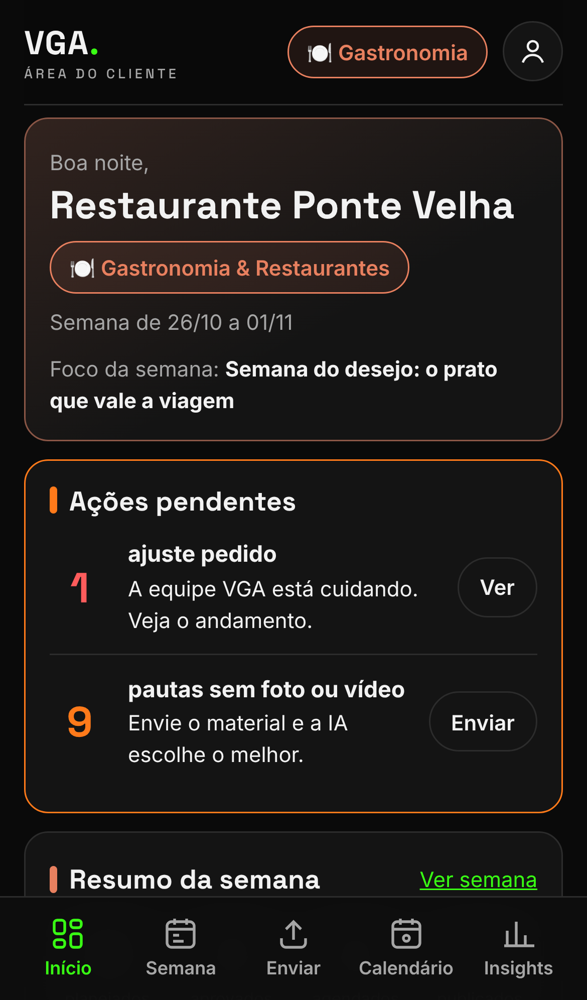
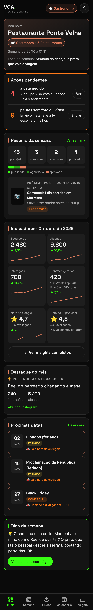
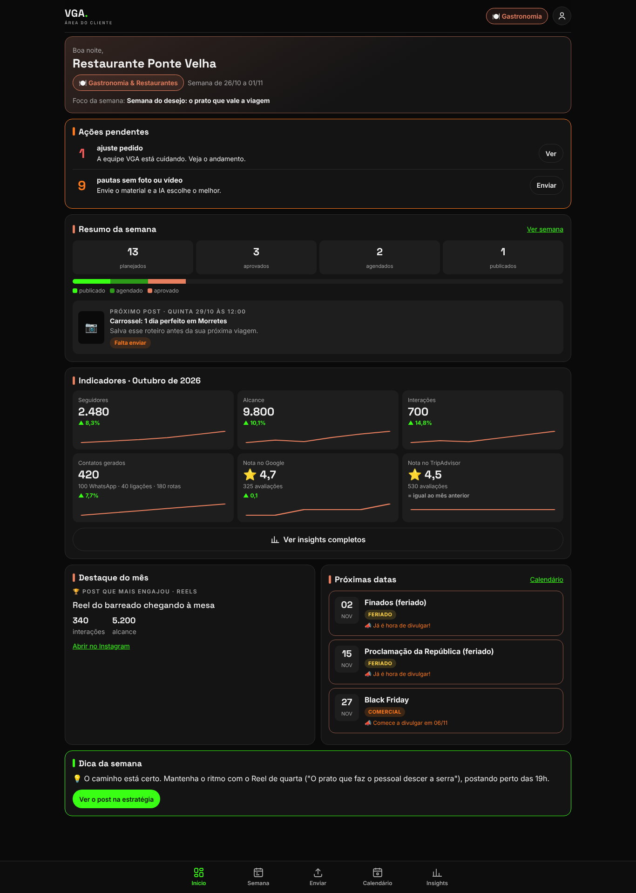

# VGA • Área do Cliente

Site (feito primeiro para o celular) onde cada cliente da VGA Gestão de Negócios entra com login e senha e recebe a **estratégia de conteúdo da semana** do seu nicho: pauta diária, ganchos, roteiros e legendas prontas para Reels, carrosséis, feed e Stories.



## Como o cliente usa

1. **Entra** com o e-mail e a senha que a VGA enviou.
2. **Escolhe o nicho** entre os 10 do mapa "VGA • Estratégia Segmentada — 10 Nichos Lucrativos" (pode trocar depois).
3. Cai no **Início** (Dashboard), que reúne tudo em cartões (veja abaixo).
4. Na **Semana**, vê o **resumo do nicho**: objetivo, os 5 pilares com a porcentagem, o volume do mês e as regras da profissão (quando existem).
5. Logo abaixo, a **estratégia da semana**: um cartão por dia, com formato, horário, gancho, roteiro, legenda (com botão de copiar) e o que fotografar ou gravar.
6. Na aba **Enviar**, sobe fotos e vídeos. A **IA** dá uma nota a cada arquivo, escolhe o melhor para cada pauta e define a legenda e o horário.
7. **Aprova** cada post, ou toca em **Pedir ajuste** e escreve o que quer mudar. Nada é publicado sem aprovação.
8. Na aba **Calendário**, vê as datas comerciais, os feriados, as datas de natureza e as campanhas de saúde, com o aviso de quando começar a divulgar.
9. Na aba **Insights**, acompanha o desempenho do negócio no Instagram/Facebook, no Google e no TripAdvisor.

No topo da semana fica o **painel de pendências**: falta enviar, para aprovar, em ajuste e aprovados.

No celular, o menu fixo embaixo tem **Início, Semana, Enviar, Calendário e Insights**. A conta (trocar senha, sair) fica no botão redondo do topo. Para a equipe VGA, "Enviar" dá lugar ao **Painel**.

## Início (Dashboard)

É a primeira tela depois do login. Cartões em uma coluna no celular e em grade no computador, nesta ordem:

1. **Saudação** com o nome do negócio, o nicho (com a cor dele) e a semana atual.
2. **Ações pendentes:** posts para aprovar, ajustes pedidos e fotos/vídeos que faltam. Cada um tem um botão que leva direto ao post certo.
3. **Resumo da semana:** posts planejados, aprovados, agendados e publicados, com barra de progresso, e o próximo post (dia, horário e prévia).
4. **Indicadores principais** do último mês lançado: seguidores, alcance, interações, contatos gerados (WhatsApp, link, ligações, rotas e site) e nota no Google e no TripAdvisor. Cada um mostra a variação contra o mês anterior e um mini gráfico de 6 meses. Tem também o botão "Ver insights completos".
5. **Destaque do mês:** o post que mais engajou.
6. **Próximas datas:** as 3 próximas do calendário do nicho, com o aviso de quando começar a divulgar.
7. **Dica da semana:** uma recomendação em linguagem simples que liga os números à estratégia, com botão para abrir o post.

Sem números lançados, cada cartão mostra uma mensagem amigável no lugar de zeros.

| Celular | Computador |
|---|---|
|  |  |

Cliente novo, ainda sem números: [docs/prints/dashboard-vazio-celular.png](docs/prints/dashboard-vazio-celular.png).

## Insights

**Resumo geral** no topo: nota média das avaliações (Google e TripAdvisor, ponderada pelo número de avaliações), crescimento de seguidores e contatos gerados. Abaixo há uma sub-aba por fonte:

| Fonte | O que mostra |
|---|---|
| 📸 Instagram/Facebook | seguidores, alcance, contas com engajamento, interações, visualizações de Reels, visitas ao perfil, cliques no link e no WhatsApp, melhores posts, horários com mais seguidores online, cidades e idade do público |
| 📍 Google (Perfil da Empresa) | visualizações no Maps e na Pesquisa, ligações, pedidos de rota, cliques no site, nota média, número de avaliações e últimas avaliações (marcando as sem resposta) |
| 🦉 TripAdvisor | nota, número de avaliações, posição no ranking da cidade, selos (ex.: Travellers' Choice) e últimas avaliações |

Em cada fonte aparecem:

- **cartões** com os números do mês e a variação contra o mês anterior: seta **verde** quando melhora e **laranja** quando piora. No ranking, cair de posição é melhorar;
- um **gráfico de evolução** de 6 meses, com as métricas principais para escolher;
- o bloco **"O que isso significa"**, com 2 ou 3 leituras em linguagem simples e uma recomendação ligada a um post da estratégia da semana, com link para ele;
- o comentário da equipe VGA, quando houver.

Fotos da tela: [Insights no celular](docs/prints/insights-celular.png) · [Google no computador](docs/prints/insights-google-computador.png).

### Como os números entram (Fase 1)

A equipe VGA lança os números no **Painel → Insights**: escolhe o cliente, o mês e a fonte, preenche o formulário e salva. O cliente só visualiza.

Para lançar muitos de uma vez, use a **importação de planilha CSV**. No mesmo painel há o botão **Baixar modelo**. Formato de uma informação por linha:

```csv
email;mes;fonte;campo;valor
cliente@exemplo.com;2026-10;instagram;seguidores;2.480
cliente@exemplo.com;2026-10;google;nota_media;4,7
cliente@exemplo.com;2026-10;google;ultimas_avaliacoes;Maria S. | 5 | 2026-10-12 | Comida maravilhosa | sim
cliente@exemplo.com;2026-10;tripadvisor;selos;Travellers' Choice 2026
```

- Aceita `;` ou `,` como separador, números no formato brasileiro (`1.234` e `4,7`) e textos entre aspas.
- Nas listas (avaliações, melhores posts, horários, cidades, idades e selos), cada linha acrescenta um item, com as partes separadas por `|`.
- Primeiro o painel **confere** a planilha e mostra os erros com o número da linha. A gravação é **tudo ou nada**: com qualquer erro, nada é salvo. Os campos importados se juntam ao que já existia no mês.

### Conexão automática com as APIs (Fase 2)

A estrutura já está pronta em `src/insights/conectores.js`. Cada conector sabe quais chamadas fazer e converte a resposta para os mesmos campos do formulário (com testes). A tabela `conexoes_insights` guarda a conta de cada cliente. Falta guardar os tokens com segurança, criar o botão "Conectar" e agendar a busca mensal.

O que criar em cada plataforma:

**Meta (Instagram/Facebook) — Meta Graph API**
1. Instagram do cliente como conta **Profissional** (Empresa ou Criador), ligada a uma **Página do Facebook**.
2. Um app da VGA em developers.facebook.com, do tipo **Empresa**, com o produto Instagram.
3. Permissões `instagram_basic`, `instagram_manage_insights`, `pages_show_list` e `pages_read_engagement` (Login do Facebook), ou `instagram_business_basic` e `instagram_business_manage_insights` (Login do Instagram).
4. **Verificação da empresa** no Gerenciador de Negócios e **Análise do App** (App Review), com vídeo mostrando a tela de Insights.
5. Política de privacidade publicada. Cada cliente autoriza uma vez.
6. Variáveis `META_APP_ID` e `META_APP_SECRET`. Dados de público e horários online só aparecem com 100 seguidores ou mais.

**Google — Business Profile Performance API (+ API de avaliações v4)**
1. Projeto no Google Cloud com as APIs *Business Profile Performance*, *My Business Account Management* e *My Business Business Information* ativadas.
2. Pedido de acesso pelo formulário **"Application for Basic API Access"**. Cota 0 significa "ainda não aprovado"; a análise leva até cerca de 2 semanas.
3. Perfil verificado e ativo há 60 dias ou mais, com site. O e-mail do pedido precisa ser dono ou administrador do perfil.
4. Tela de consentimento OAuth publicada, escopo `https://www.googleapis.com/auth/business.manage` e um ID de cliente OAuth do tipo Web.
5. Variáveis `GOOGLE_CLIENT_ID` e `GOOGLE_CLIENT_SECRET`, com a VGA como administradora de cada perfil.

**TripAdvisor — continua manual**
A Content API antiga foi desligada em 31/08/2026. A substituta (Terra API) só entrega dados **públicos** do local (nota, número de avaliações, ranking e até 5 avaliações), com regras de exibição. Não existe API com os dados do dono (painel do Management Center). Por isso a equipe VGA copia os números do painel do TripAdvisor.

## Painel VGA (equipe)

Quem tem acesso de equipe vê a aba **Painel**, com quatro partes:

- **Estratégias:** situação da semana atual e da próxima de cada nicho, com botões para gerar com IA na hora.
- **Aprovados e ajustes:** fila do que os clientes aprovaram (arquivo, legenda final, dia e horário), pronta para agendar, e os pedidos de ajuste. A equipe marca cada post como **agendado** e depois **publicado**; isso aparece no resumo da semana do cliente.
- **Insights:** formulário por cliente, mês e fonte, e importação de planilha CSV (veja "Insights").
- **Clientes:** cria acessos (gera a senha e a mensagem pronta para mandar no WhatsApp), troca senha, nicho, negócio e cidade, e desativa acessos.

O nome do negócio e a cidade de cada cliente entram automaticamente nas legendas.

## Atualização semanal pela IA

A cada hora o servidor confere se há algo a fazer:

- **Semana atual:** se ainda está no modelo pronto e nenhum cliente começou a trabalhar nela, a IA gera a versão atualizada.
- **Próxima semana:** a partir de sexta-feira, a IA já prepara a semana seguinte.

Em cada geração, a IA (Claude) primeiro **pesquisa na web** o que está em alta para o nicho (formatos, temas, mudanças nas plataformas e nas regras da profissão). Depois cruza isso com os pilares, a semana-tipo, as datas das próximas 5 semanas e a semana anterior, para não repetir. As fontes aparecem para o cliente em "Fontes da pesquisa".

Se uma semana é gerada de novo, as pautas que o cliente **já aprovou ficam guardadas**. As que ainda não foram aprovadas são trocadas pelas novas.

Sem a chave da API, o site funciona igual com o **modelo de semana pronto** de cada nicho (`conteudo/semanas/`). A distribuição dos arquivos passa a ser simples: vídeo vertical vai para Reels e Stories, foto vai para o feed.

Também dá para rodar a geração pelo terminal:

```bash
npm run atualizar-semana
```

```bash
npm run atualizar-semana -- gastronomia proxima
```

## Rodar no computador

Precisa do Node.js 22.13 ou mais novo.

```bash
cd area-do-cliente
```

```bash
npm install
```

```bash
cp .env.example .env
```

Preencha `ADMIN_EMAIL` e `ADMIN_SENHA` no `.env` (e a `ANTHROPIC_API_KEY`, se quiser a IA ligada). Depois:

```bash
npm start
```

Abra http://localhost:3000, entre com o e-mail da equipe e crie os clientes no Painel VGA.

Para rodar os testes:

```bash
npm test
```

## Publicar no Railway

Mesmo esquema do VGA App (Docker):

1. No Railway, crie um serviço a partir deste repositório e defina **Root Directory = `area-do-cliente`**. O Railway lê o `railway.json` e usa o `Dockerfile`.
2. Adicione um **Volume** montado em `/data`. É lá que ficam o banco, as fotos e os vídeos. Sem o volume, tudo some a cada nova publicação.
3. Em **Variables**, preencha:
   - `ANTHROPIC_API_KEY`: chave da API do Claude
   - `ADMIN_EMAIL` e `ADMIN_SENHA`: primeiro acesso da equipe VGA
   - opcionais: `MAX_VIDEO_MB` (padrão 300) e `MAX_FOTO_MB` (padrão 25)
4. Gere o domínio em **Settings → Networking**. A verificação de saúde usa `/api/saude`.

## Estrutura

```
area-do-cliente/
  server.js              servidor (rotas do cliente e do painel)
  src/
    auth.js              login e sessões (mesma base do VGA App)
    db.js                banco SQLite
    estrategia.js        monta, guarda e personaliza a semana
    ia.js                Claude: pesquisa de tendências, estratégia e análise de fotos e vídeos
    gerador.js           atualização semanal automática
    arquivos.js          recebimento de fotos e vídeos
    datas.js             semanas (fuso de Brasília)
    insights/
      campos.js          campos de cada fonte e validação (números no formato brasileiro)
      analise.js         variação, gráfico, resumo geral e "O que isso significa"
      repositorio.js     leitura, gravação e importação de CSV
      conectores.js      Fase 2: Meta Graph API e Google Business Profile (TripAdvisor manual)
  conteudo/
    nichos.js            os 10 nichos: objetivo, pilares, volume, regras e semana-tipo
    semanas/*.js         modelo de semana de cada nicho, com textos prontos
    calendario.js        datas de nov/2026 a dez/2027
  public/                telas (HTML, CSS e JavaScript, sem framework)
  scripts/               atualizar-semana e criar-admin
  test/                  testes automáticos
  docs/prints/           fotos das telas no celular e no computador
```

## Próximas fases

- Publicação automática pelo Metricool depois da aprovação (hoje a fila de aprovados fica no Painel VGA).
- Datas locais de Morretes no calendário.
- Avisos por WhatsApp ou e-mail quando a semana nova sai e quando falta aprovar.
- Vídeos grandes guardados no Google Drive ou em armazenamento externo.
- Conexão automática dos Insights com a Meta e o Google (estrutura pronta; ver "Fase 2").
- Relatório mensal em PDF a partir dos Insights.
